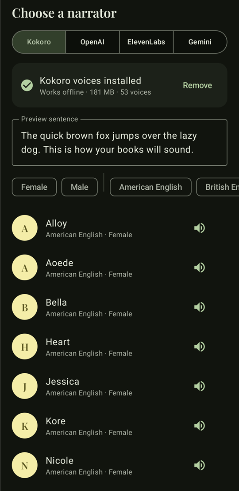
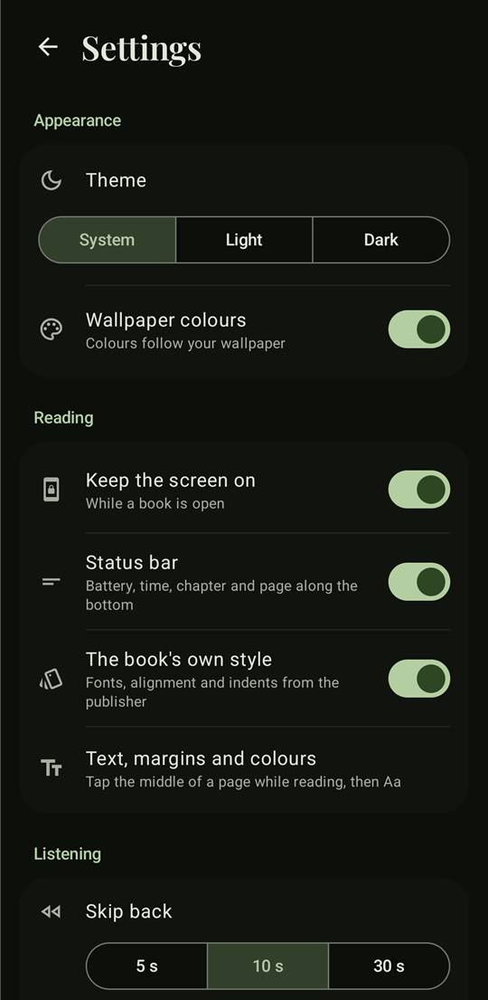
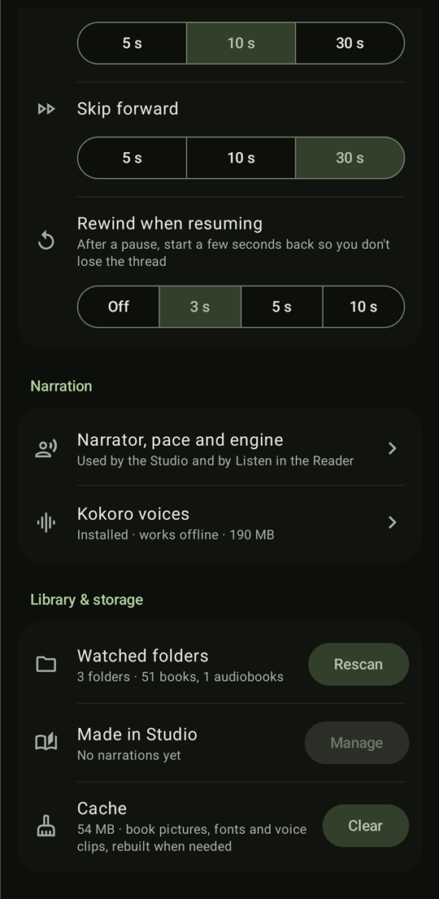

<div align="center">

# OmniRead

**Read your books, listen to your audiobooks, and turn any book into an audiobook, all on your phone.**

An open-source Android eBook reader, audiobook player and on-device narration studio powered by [Kokoro-82M](https://huggingface.co/hexgrad/Kokoro-82M).

[](https://github.com/chhunseang/OmniRead/releases)
[](LICENSE)


[Download](#download) · [Features](#features) · [Building](#building-from-source) · [Roadmap](#roadmap) · [Contributing](#contributing)

</div>

> [!WARNING]
> OmniRead is **alpha software** (v0.0.1). It works well day to day on the developer's own phone, but expect rough edges, missing features and breaking changes between releases. Please [report what you find](https://github.com/chhunseang/OmniRead/issues).

<!-- AUTHOR'S NOTE: add your own words about why OmniRead exists here. -->

## Screenshots

<p align="center">
  
  &nbsp;
  
  &nbsp;
  
</p>

## Features

OmniRead has three tabs: **Library** for the books you read, **Listen** for audiobooks, and **Studio** to narrate books into audiobooks.

### 📖 Library & Reader

- **Formats:** EPUB 2/3 (best supported), plus MOBI/AZW3, FB2, TXT and PDF.
- **Your book, as published:** honours the book's own stylesheet (fonts, alignment, indents, headings) and embedded fonts, including obfuscated IDPF/Adobe fonts. Every illustration and picture page is shown inline.
- **Typography:** font, size, weight, line and paragraph spacing, justification and hyphenation. Margins are set per side.
- **Themes:** day, night and sepia-style themes with optional paper, linen and canvas textures. A blue-light filter and in-reader brightness are included.
- **Paged or continuous scrolling,** with configurable tap zones.
- **Chapter pull:** drag past the end of a chapter to rubber-band into the next one, with a subtle haptic snap.
- **Live page slider:** scrub through the chapter page by page, with haptic ticks.
- **Status line:** battery, clock, chapter name and page along the bottom edge.
- **Continue reading** picks up exactly where you left off. The shelf can be filtered by Reading, Not started, Finished or Favorites, and searched (pull down on the shelf).
- **Watched folders:** add a folder once and every book in it and its subfolders is imported. New files appear on rescan.
- **Read aloud:** any book can be read to you by the Studio narrator, live, without saving anything.

### 🎧 Listen

- Plays **M4B, M4A, MP3** and other common formats, either as single files or as folders with one file per chapter.
- **Real chapter lists:** reads the chapter markers embedded in M4B/M4A files, in both QuickTime chapter-track and Nero `chpl` formats.
- **Continue listening,** a **mini player** above the tab bar, and a full-screen **Now Playing** view with a per-chapter scrubber.
- Variable **speed**, a **sleep timer** (shake to extend), and **bookmarks** with notes.
- **Skip silence** and **voice boost**.
- **Lock-screen, notification, headset and car controls** via Media3, with cover art.
- **Rewind on resume:** after a pause, playback starts a few seconds back so you don't lose the sentence.
- **Configurable skip** intervals (5, 10 or 30 s).
- **Follow-along text** for Studio narrations: the sentence being read is highlighted.
- The shelf shows **Your files** and **Made in Studio** separately. Long-press any audiobook for its details and actions.

### 🎙️ Studio: make your own audiobooks

- **On-device neural narration** with Kokoro-82M through [sherpa-onnx](https://github.com/k2-fsa/sherpa-onnx). It offers 53 voices across American and British English and more, and works completely offline after a one-time voice download of about 130 MB (about 180 MB once installed).
- **Optional cloud voices** (OpenAI, ElevenLabs, Gemini) using your own API key.
- **Narrator picker:** filter by gender and accent, and preview any voice with your own sentence.
- **Pick chapters:** "story only" is selected by default, so covers, the table of contents and copyright pages are skipped. Each chapter shows a length estimate.
- **Exports M4B (AAC) or WAV** with chapter markers. An optional sentence-timing sidecar (LRC + JSON) powers follow-along text.
- **Runs in the background** with WorkManager and a progress notification showing the current chapter and time left. You can leave the app.
- **Share, save to phone, or delete** any narration. Each chapter selection becomes its own audiobook, so narrating chapters 11–20 never overwrites chapters 1–10.

### ⚙️ Settings

Theme (System, Light or Dark) with Material You wallpaper colours, reading defaults, skip intervals, rewind on resume, narrator and voice management, watched folders, storage used by Studio narrations, and a cache cleaner.

## Privacy

- **No account, no ads, no analytics, no tracking.**
- Your books and audiobooks never leave your phone.
- The app only goes online to **download the Kokoro voices** (once, from the official sherpa-onnx release) and, **if you choose a cloud voice**, to send text to that provider with your own key.

## Download

Grab the latest APK from the [**Releases**](https://github.com/chhunseang/OmniRead/releases) page and install it. You may need to allow installs from your browser or file manager.

**Requirements**

| | |
|---|---|
| Android | 7.0 (API 24) or newer |
| CPU | 64-bit ARM (`arm64-v8a`), which covers practically every phone from 2017 onwards |
| Storage | ~50 MB download for the app, plus ~180 MB if you install the Kokoro voices |

On a Pixel 6, Kokoro narration runs at roughly **half real-time**: one hour of audio takes about two hours to make.

## Building from source

**Prerequisites:** Android Studio (Ladybug or newer) or JDK 17+, and the Android SDK with API 36.

```bash
git clone https://github.com/chhunseang/OmniRead.git
cd OmniRead
./gradlew assembleDebug
```

The debug APK is written to `app/build/outputs/apk/debug/`.

**Release builds** are signed only when a keystore is supplied through environment variables. Nothing secret lives in the repo:

```bash
export KEYSTORE_PATH=/path/to/release.jks
export STORE_PASSWORD=...
export KEY_PASSWORD=...        # key alias: "upload"
./gradlew assembleRelease
```

Without those variables, `assembleRelease` produces an unsigned APK, which is what F-Droid expects. Dependencies come from Google Maven, Maven Central and JitPack (sherpa-onnx only); there are no bundled binaries.

## Tech stack

| Area | Libraries |
|---|---|
| UI | Kotlin, Jetpack Compose, Material 3 (dynamic colour) |
| Architecture | MVVM, Hilt, Kotlin coroutines & Flow |
| Storage | Room, DataStore |
| Books | Readium Kotlin Toolkit, Jsoup (custom CSS engine & paginator) |
| Audio | AndroidX Media3 (ExoPlayer, MediaSession), MediaCodec/MediaMuxer for AAC export |
| Narration | sherpa-onnx + Kokoro-82M (int8, on-device); OkHttp/Retrofit for optional cloud TTS |
| Background work | WorkManager (foreground service) |

```
app/src/main/java/com/example/
├── data/        audio playback, library scanning, book parsing, TTS engines, Room
├── domain/      engine interfaces and models (reader, audio, TTS)
├── di/          Hilt modules
└── ui/          Compose screens: library, reader, audio, converter (Studio), settings
```

## Roadmap

Ideas being considered (not promises):

- [ ] More reader polish: highlights and notes UI, dictionary lookup, in-book search results view
- [ ] Studio: pause and resume long narrations, a queue that survives app restarts, more languages
- [ ] Sync reading position between a book and its narration
- [ ] OPDS catalogue support
- [ ] x86_64 / 32-bit ARM builds
- [ ] F-Droid release

## Contributing

Bug reports, ideas and pull requests are welcome.

1. Check the [issues](https://github.com/chhunseang/OmniRead/issues) to see whether it's already known.
2. For bugs, include your phone model, Android version, the app version and the steps to reproduce. For reading issues, say which book format.
3. For pull requests, keep changes focused and follow the existing code style (Kotlin, Compose, MVVM with Hilt).

## Acknowledgements

- [Kokoro-82M](https://huggingface.co/hexgrad/Kokoro-82M) by hexgrad: the voice model (Apache-2.0)
- [sherpa-onnx](https://github.com/k2-fsa/sherpa-onnx) by k2-fsa: on-device inference (Apache-2.0)
- [Readium Kotlin Toolkit](https://github.com/readium/kotlin-toolkit) (BSD-3-Clause)
- [Literata](https://github.com/googlefonts/literata) and [Playfair Display](https://github.com/clauseggers/Playfair) fonts (SIL OFL 1.1)
- Inspired by the reading comfort of Moon+ Reader and the listening flow of Smart AudioBook Player

See [NOTICE.md](NOTICE.md) for third-party licences.

## License

OmniRead is free software: you can redistribute it and/or modify it under the terms of the **GNU General Public License v3.0** or (at your option) any later version. See [LICENSE](LICENSE).

```
Copyright (C) 2026 Chhunseang
```
